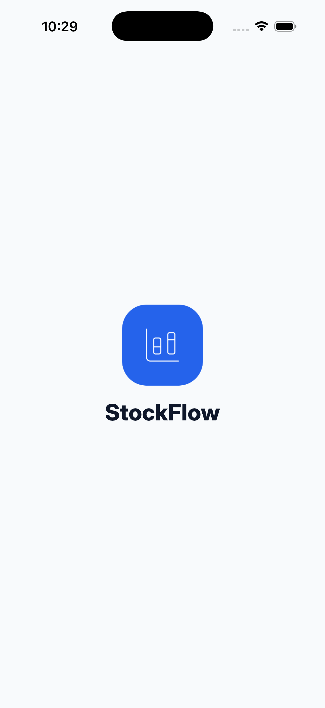
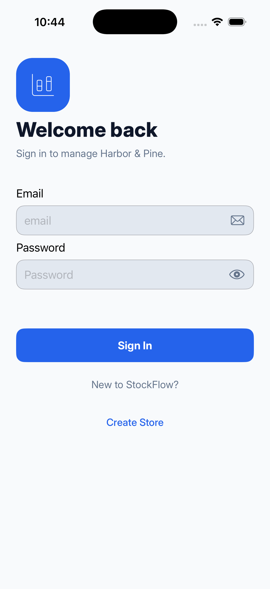
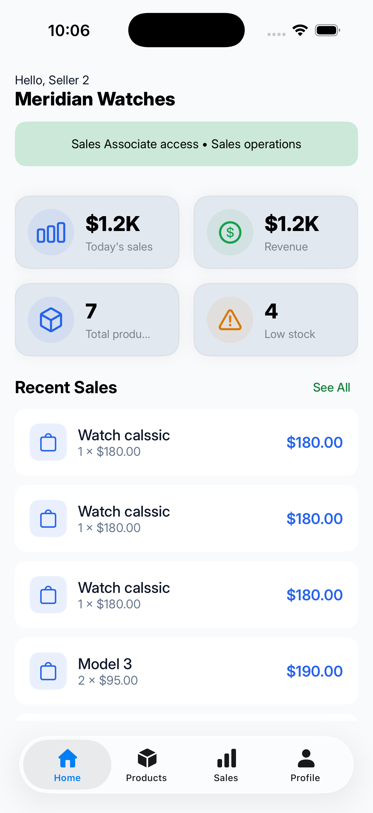
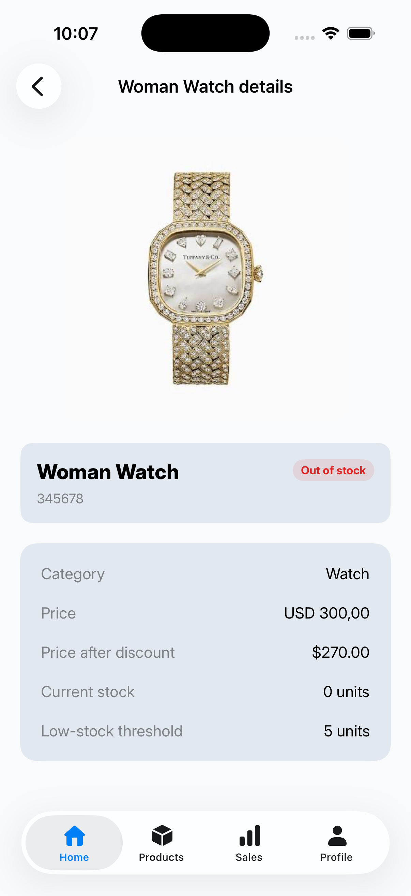
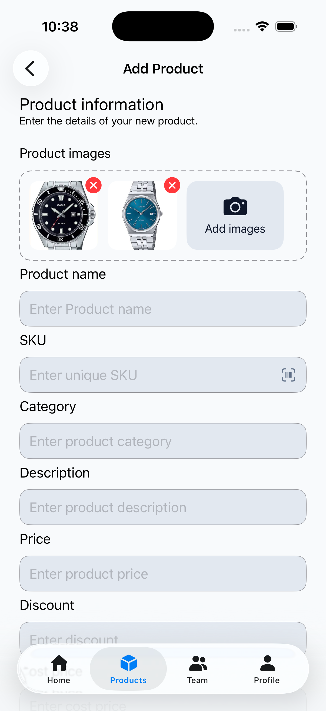
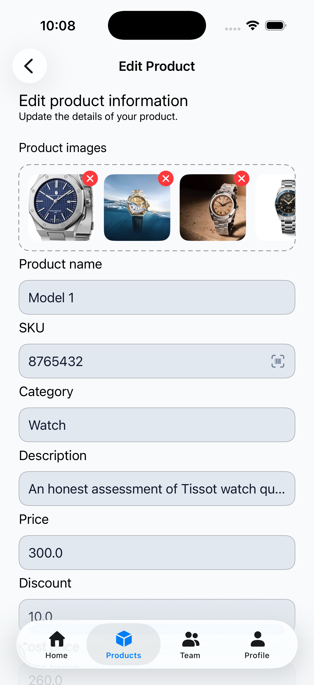
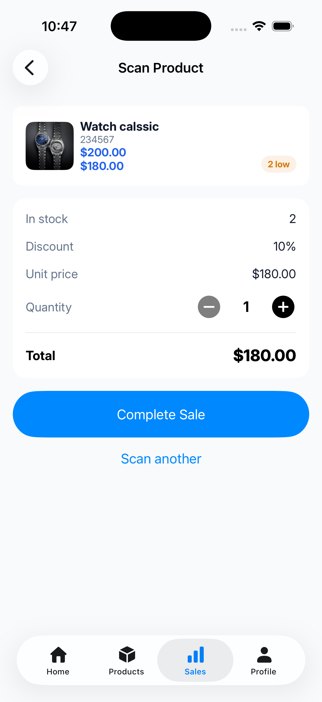
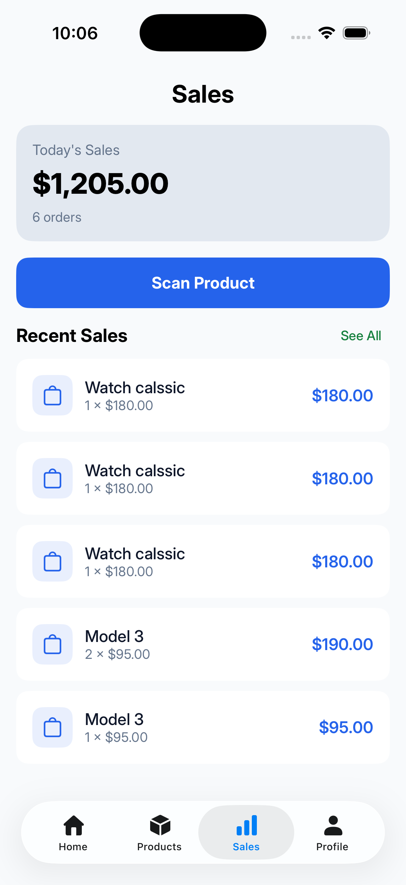
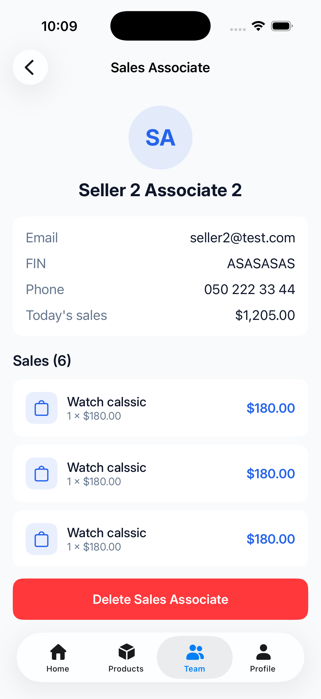
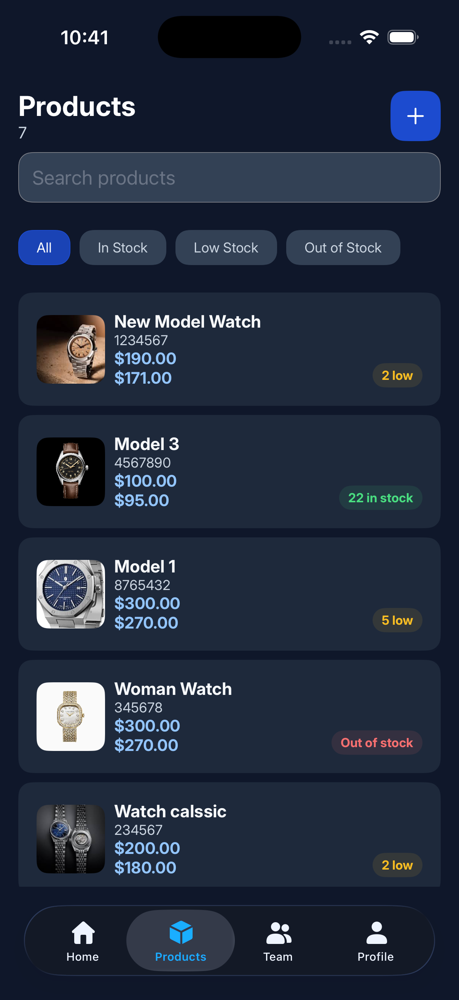

# StockFlow


StockFlow is an inventory and sales management app for small stores, built with SwiftUI.
A store **owner** manages products, the sales team and sales reports.
A **sales associate** scans products and records sales.

## Screenshots

| Splash | Login | Products |
|:--:|:--:|:--:|
|  |  |  |

| Product Detail | Add Product | Edit Product |
|:--:|:--:|:--:|
|  |  |  |

| Scan Product | Sales | Sale Details |
|:--:|:--:|:--:|
|  |  |  |

| Dark Mode |
|:--:|
|  |

## Features

**Owner**
- Dashboard with today's sales, orders, low-stock products and recent sales
- Product management: create, edit, delete, up to 5 images, barcode (SKU) scanning
- Team management: add and remove sales associates, view each associate's sales
- Sales history with details

**Sales associate**
- Scan a product barcode (or enter the SKU manually) and complete a sale
- Own sales history and profile

**General**
- Splash screen while the session is restored
- JWT authentication, token stored in Keychain, automatic logout when the session expires
- Pagination, pull to refresh
- Loading, error and empty states on every screen
- Dark mode support

## Tech Stack

- SwiftUI, NavigationStack, TabView, sheets
- Observation (`@Observable`), `@State`, `@Binding`
- Swift Concurrency (`async/await`)
- URLSession-based network layer
- Keychain for secure token storage
- PhotosUI (image picking), VisionKit `DataScanner` (barcode scanning)
- Swift Testing + XCTest (unit and UI tests)
- GitHub Actions (CI)
- Backend: Node.js, Express, SQLite ([StockFlowBackend](https://github.com/CicekAzizova/StockFlowBackend))

## Architecture

The app follows **MVVM** with a repository layer and dependency injection.

```
View  →  ViewModel  →  Store / Repository  →  NetworkService  →  API
```

- **View**: SwiftUI views, no business logic or networking.
- **ViewModel**: `@Observable` classes that hold screen state (`idle / loading / loaded / error`) and call repositories.
- **Repository**: protocols (`ProductRepository`, `SalesRepository`, ...) with default implementations on top of `NetworkService`. Protocols make them easy to mock in tests.
- **Stores**: `ProductsStore` and `SalesStore` keep shared data in sync across screens (Home, Products, Low Stock, Product Detail).
- **Dependency injection**: `AppDependencies` creates repositories and builds every ViewModel.
- **Networking**: `Endpoint` protocol describes requests; `NetworkService` executes them. A `401` response posts a notification that logs the user out.

### Project structure

```
StockFlow/
├── App/            app entry point, app state, routing
├── Core/           config, DI, extensions, navigation, network, security, stores, reusable UI
├── Features/       Owner, SalesAssociate and Shared screens (View + ViewModel + State)
├── Models/         request and response models
├── Repositories/   repository protocols and implementations
└── Resources/      fonts, assets
StockFlowTests/     unit tests and mocks
StockFlowUITests/   UI tests
```

## Getting Started

> The app needs the backend running on the same Mac. Start it first, then run the app.

**Requirements:** Xcode 26+, Node.js 18+

### 1. Run the backend
```bash
git clone https://github.com/CicekAzizova/StockFlowBackend.git
cd StockFlowBackend
npm install
npm start
```
The server runs on `http://localhost:3000`. API docs: `http://localhost:3000/api-docs`.

### 2. Run the app
```bash
git clone https://github.com/CicekAzizova/StockFlow.git
open StockFlow/StockFlow.xcodeproj
```
Select an iPhone simulator and press `Cmd + R`. The simulator connects to `http://localhost:3000` automatically.

### Test accounts
| Role | Email | Password |
|------|-------|----------|
| Owner | owner@gmail.com | 123456 |
| Sales associate | seller2@test.com | 1234567 |

### Real device (optional)
Barcode scanning needs a real device (the simulator has no camera; use manual SKU entry there).
Set your Mac's IP in `StockFlow/Core/Config/AppConfig.swift` (`ipconfig getifaddr en0`).
The iPhone and the Mac must be on the same Wi-Fi network.

## Testing

- **Unit tests** (`StockFlowTests`): `LoginViewModel`, `ProductViewModel`, `ScanProductViewModel` and string validation. Repositories are replaced with mocks, so tests never call the real API. Both success and error cases are covered.
- **UI tests** (`StockFlowUITests`): login screen.
- Run all tests in Xcode with `Cmd + U`.
- **CI**: GitHub Actions runs the unit tests on every push and pull request (`.github/workflows/tests.yml`).
